  <a href="README.md">🇧🇷 Leia em Português</a>

<h1 align="left">Hi , I'm Rafael Silva</h1>

  
  

### 🧠 Software Quality Analyst & QA Engineer

I am a Software Quality specialist certified by **CTFL (ISTQB)**, focused on ensuring excellence, stability, and security in the projects I work on. I apply the *Shift-Left Testing* culture, integrating quality from software conception all the way to production delivery.

- 🛡️ **Engineering & Standards:** I execute test planning and modeling strictly aligned with **ISTQB** standards.
- 🤖 **AI-Driven QA:** I actively use **Artificial Intelligence** tools in my projects to leverage test scenario creation, optimize locators, generate mock data, and refactor automation code across multiple languages.
- ⚙️ **Cross-Platform Automation:** Specialist in creating robust E2E automation frameworks and scripts for **Web, API, and Mobile**.
- 📚 **Continuous Evolution:** Always staying at the forefront of software quality, integrating new CI/CD technologies and Clean Code practices for QA.
- 🎮 **Beyond Code:** Passionate about geek culture, gaming, series, and good movies.

 

### 🛠️ Tech Stack & Tools

  
  
  

### ⚙️ GitHub Analytics

  

### 👾 My Contributions

  <picture>
    <source media="(prefers-color-scheme: dark)" srcset="https://raw.githubusercontent.com/RafaelJrS/RafaelJrS/output/pacman-contribution-graph-dark.svg">
    <source media="(prefers-color-scheme: light)" srcset="https://raw.githubusercontent.com/RafaelJrS/RafaelJrS/output/pacman-contribution-graph.svg">
    
  </picture>

### 🤝 Let's Connect!

  
  

