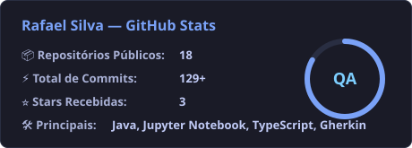

  <b>🇧🇷 Português</b> | <a href="README-en.md">🇺🇸 English</a>

<h1 align="left">Olá , sou Rafael Silva</h1>

  
  

### 🧠 Analista e Engenheiro de Qualidade de Software (QA)

Sou um especialista em Qualidade de Software certificado pela **CTFL (ISTQB)**, com foco em garantir a excelência, estabilidade e segurança dos projetos em que atuo. Aplico a cultura de *Shift-Left Testing*, integrando a qualidade desde a concepção do software até a entrega em produção.

- 🛡️ **Engenharia e Padrões:** Executo o planejamento e a modelagem de testes rigorosamente alinhados às normativas da **ISTQB**.
- 🤖 **AI-Driven QA:** Utilizo ativamente ferramentas de **Inteligência Artificial** nos meus projetos para potencializar a criação de cenários, otimizar *locators*, gerar massa de dados e refatorar códigos de automação em múltiplas linguagens.
- ⚙️ **Automação Multi-Plataforma:** Especialista na criação de frameworks e scripts robustos de automação E2E para **Web, API e Mobile**.
- 📚 **Evolução Contínua:** Mantenho-me na vanguarda da qualidade de software, integrando novas tecnologias de CI/CD e Clean Code para QA.
- 🎮 **Além do Código:** Apaixonado por cultura geek, jogos, séries e bons filmes.

  
🇺🇸 <b>Read summary in English</b> <i>(ou clique em "🇺🇸 English" no topo para abrir a página em inglês)</i>

   
  I am a Software Quality specialist certified by <b>CTFL (ISTQB)</b>, focused on ensuring excellence, stability, and security in the projects I work on. I apply the <i>Shift-Left Testing</i> culture, integrating quality from software conception all the way to production delivery.
  <ul>
    <li>🛡️ <b>Engineering & Standards:</b> Test planning and modeling strictly aligned with <b>ISTQB</b> standards.</li>
    <li>🤖 <b>AI-Driven QA:</b> Actively leveraging <b>AI tools</b> to design test scenarios, optimize locators, generate test data, and refactor automation code.</li>
    <li>⚙️ <b>Cross-Platform Automation:</b> Robust E2E automation frameworks for <b>Web, API, and Mobile</b>.</li>
    <li>📚 <b>Continuous Evolution:</b> CI/CD integration and Clean Code practices for QA.</li>
  </ul>

 

### 🛠️ Stack Tecnológica e Ferramentas

  
  
  
  
  

### 🚀 Projetos de Automação em Destaque

| Projeto | Stack | Descrição |
| :--- | :--- | :--- |
| 🔹 **[Play-swaglabs](https://github.com/RafaelJrS/Play-swaglabs)** | `Playwright` `TypeScript` | Automação de testes E2E no Swag Labs com arquitetura moderna em Playwright. |
| 🤖 **[swaglabs_robotframework](https://github.com/RafaelJrS/swaglabs_robotframework)** | `Robot Framework` `Python` | Suíte de testes automatizados E2E estruturada com Robot Framework. |
| 🛒 **[AmazonTesteRobot](https://github.com/RafaelJrS/AmazonTesteRobot)** | `Robot Framework` `BDD` | Automação de fluxos de busca e validação no e-commerce da Amazon. |
| ☕ **[SeuBarrigaSeleniumWebDriver](https://github.com/RafaelJrS/SeuBarrigaSeleniumWebDriver)** | `Selenium` `Java` | Automação de testes funcionais Web utilizando Java e Selenium WebDriver. |

### ⚙️ GitHub Analytics

  

### 👾 Minhas Contribuições

  <picture>
    <source media="(prefers-color-scheme: dark)" srcset="https://raw.githubusercontent.com/RafaelJrS/RafaelJrS/output/pacman-contribution-graph-dark.svg">
    <source media="(prefers-color-scheme: light)" srcset="https://raw.githubusercontent.com/RafaelJrS/RafaelJrS/output/pacman-contribution-graph.svg">
    
  </picture>

### 🤝 Vamos Conectar!

  
  

